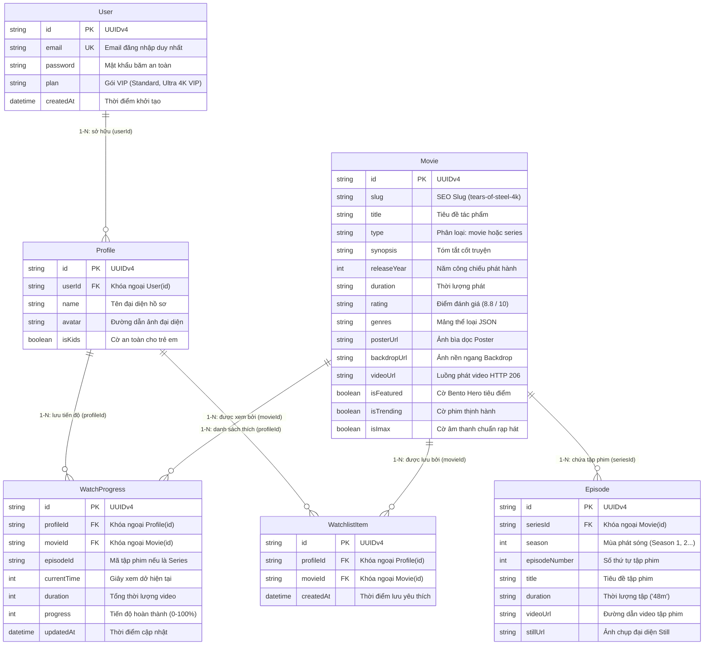

# 🎬 AuraNova (CineStream) - Modern Cinema Dark-Themed VOD Streaming Platform

[](#)
[](#)
[](#)
[](#)
[](#)
[](#)
[](#)
[](#)

> **AuraNova** là nền tảng website xem phim trực tuyến hiện đại (Video-on-Demand / OTT Platform) được xây dựng theo phong cách **Cinema Dark Theme** cao cấp. Ứng dụng mang lại trải nghiệm xem phim đắm chìm như tại rạp chiếu với thanh điều hướng cánh trái thông minh (Left Dock), khối tiêu điểm Bento Hero trình chiếu 4K, cơ chế phát luồng video phân đoạn **HTTP 206 Partial Content Range Streaming**, hệ thống đa hồ sơ gia đình (Multi-Profile) và cơ sở dữ liệu quan hệ nhúng **SQLite** đạt chuẩn 3NF.

---

## 📑 Mục Lục
- [1. Tính Năng Nổi Bật](#1-tính-năng-nổi-bật)
- [2. Ngăn Xếp Công Nghệ (Tech Stack)](#2-ngăn-xếp-công-nghệ-tech-stack)
- [3. Kiến Trúc Cơ Sở Dữ Liệu (ERD)](#3-kiến-trúc-cơ-sở-dữ-liệu-erd)
- [4. Cấu Trúc Thư Mục Dự Án](#4-cấu-trúc-thư-mục-dự-án)
- [5. Hướng Dẫn Cài Đặt & Khởi Chạy](#5-hướng-dẫn-cài-đặt--khởi-chạy)
- [6. Danh Sách Điểm Cuối RESTful API](#6-danh-sách-điểm-cuối-restful-api)
- [7. Tài Liệu Báo Cáo Đồ Án](#7-tài-liệu-báo-cáo-đồ-án)
- [8. Thông Tin Tác Giả](#8-thông-tin-tác-giả)

---

## 1. ✨ Tính Năng Nổi Bật

### 🎨 Giao Diện Cinema Dark Theme & Bento Hero Showcase
* **Left Sidebar App Dock**: Thanh công cụ cố định cánh trái tối ưu diện tích hiển thị, hỗ trợ điều hướng nhanh giữa Trang chủ, Khám phá, Series, Danh sách yêu thích và Cài đặt.
* **Bento Hero Showcase**: Banner tiêu điểm hiện đại trình chiếu tác phẩm khoa học viễn tưởng *Tears of Steel* chuẩn 4K Ultra HD kèm hiệu ứng ánh sáng Neon Aura và các nút thao tác nhanh.
* **Mood Matrix & Trợ lý NOVA AI**: Bảng ma trận cảm xúc gợi ý phim theo tâm trạng người xem kết hợp giao diện trợ lý điện ảnh thông minh.

### ⚡ Truyền Phát Video Phân Đoạn (HTTP 206 Partial Content)
* Tự động phân đoạn dữ liệu byte video (Range Requests), giúp người xem nhảy tua đến bất kỳ mốc thời gian nào mà không bị đệm (Zero-delay seek).
* Trình phát điện ảnh **Theatrical HUD Cinema Player** tích hợp đầy đủ nút Tua 10s, Âm lượng, Toàn màn hình, Phụ đề và chế độ tự động đệm thông minh.

### 👥 Hệ Thống Đa Hồ Sơ Gia Đình (Multi-Profile)
* Cho phép một tài khoản tạo nhiều hồ sơ riêng biệt cho từng thành viên trong gia đình.
* Tích hợp chế độ bảo vệ Trẻ em (**Kids Safe Mode**) tự động sàng lọc nội dung an toàn cho lứa tuổi thiếu nhi.

### ⏱️ Tiếp Tục Xem (Continue Watching) & Bộ Sưu Tập (My List)
* Tự động lưu vết mốc thời gian đang xem dở tính bằng giây (`currentTime`) và tỷ lệ phần trăm (`progress`) vào cơ sở dữ liệu `WatchProgress`.
* Khi người xem quay lại, hệ thống sẽ tự động khôi phục đúng vị trí đã dừng trước đó.
* Quản lý bộ sưu tập phim yêu thích cá nhân (**Vault / My List**) tức thì.

### 🔍 Tra Cứu & Lọc Phim Thời Gian Thực
* Thanh tìm kiếm phản hồi trực tiếp khi gõ phím mà không cần tải lại trang.
* Ma trận thể loại đa dạng: *Sci-Fi, Hoạt hình 3D, Hành động, Viễn tưởng, Phiêu lưu, Kịch tính*.

### 💳 Bảng Giá Thành Viên & Thanh Toán An Toàn
* Phân cấp 3 gói cước linh hoạt: **Tiêu chuẩn (Standard)**, **VIP** và **Ultra 4K VIP**.
* Trang thanh toán Checkout trực quan hỗ trợ mã QR mô phỏng giao dịch thực tế.

---

## 2. 🛠️ Ngăn Xếp Công Nghệ (Tech Stack)

| Tầng kiến trúc | Công nghệ sử dụng | Vai trò & Mục đích |
| :--- | :--- | :--- |
| **Giao diện (Frontend)** | HTML5, JavaScript (ES6+), Vite 6 | Xây dựng Single/Multi-page tĩnh hiệu năng cao, module hóa component |
| **Định dạng & Phong cách** | Tailwind CSS v3, PostCSS, Glassmorphism | Thiết kế giao diện Dark Cinema, responsive mượt mà trên mọi thiết bị |
| **Máy chủ (Backend API)** | Node.js (v18+ LTS), Express.js v5.2 | Xây dựng RESTful API, phục vụ tài nguyên và xử lý phân đoạn video |
| **Truyền dẫn video** | HTTP 206 Partial Content Range Streaming | Phát luồng video MP4 trực tiếp, tối ưu bộ nhớ RAM máy chủ |
| **Cơ sở dữ liệu** | SQLite 3 (`prisma/dev.db`) | Hệ quản trị CSDL quan hệ nhúng cục bộ, phi máy chủ, đạt chuẩn ACID |
| **Tầng ORM** | Prisma Client v7 | Quản lý lược đồ `schema.prisma`, sinh mã truy vấn an toàn Type-safe |
| **Kiểm thử & Kết xuất** | Playwright Chromium Engine | Chụp ảnh màn hình nghiệm thu giao diện và kết xuất sơ đồ ERD tự động |

---

## 3. 🗄️ Kiến Trúc Cơ Sở Dữ Liệu (ERD)

Cơ sở dữ liệu của hệ thống AuraNova được chuẩn hóa nghiêm ngặt theo **dạng chuẩn 3NF**, bao gồm 06 bảng thực thể liên kết qua khóa ngoại với chính sách xóa lan truyền `ON DELETE CASCADE`:



* Sơ đồ ảnh PNG độ nét cao: `auranova_erd.png` (2840 × 1256 px).
* Sơ đồ ảnh Vector SVG: `auranova_erd.svg`.

---

## 4. 📁 Cấu Trúc Thư Mục Dự Án

```plaintext
cinestream/ (auranova/)
├── index.html                   # Trang chủ chính (Bento Hero, Movies Grid, Mood Matrix)
├── vite.config.js               # Cấu hình Vite bundler & Proxy chuyển tiếp API
├── package.json                 # Định nghĩa các dependencies và lệnh thực thi
│
├── pages/                       # Toàn bộ các trang chức năng giao diện người dùng
│   ├── watch_a_film_page.html   # Trình phát video Theatrical Cinema Player (HTTP 206)
│   ├── search_page.html         # Giao diện Tìm kiếm & Ma trận phân loại thể loại
│   ├── series_detail.html       # Chi tiết phim bộ Series và danh sách tập theo mùa
│   ├── select_profile.html      # Màn hình chọn hồ sơ "Ai đang xem?" (Multi-Profile)
│   ├── my_list.html             # Danh mục phim yêu thích cá nhân (Vault / My List)
│   ├── login.html               # Trang xác thực đăng nhập người dùng
│   ├── register.html            # Trang đăng ký tài khoản thành viên mới
│   ├── pricing.html             # Bảng giá so sánh các gói thành viên VIP
│   ├── checkout.html            # Giao diện thanh toán gói cước an toàn
│   ├── profile.html             # Trang quản lý thông tin tài khoản cá nhân
│   ├── about.html               # Giới thiệu nền tảng AuraNova
│   ├── contact.html             # Trang liên hệ và phản hồi
│   ├── help.html                # Trung tâm trợ giúp & Câu hỏi thường gặp (FAQ)
│   └── 404.html                 # Trang báo lỗi đường dẫn không tìm thấy
│
├── server/                      # Máy chủ dịch vụ trung tâm (Node.js & Express)
│   ├── index.js                 # Điểm khởi chạy máy chủ API & Streaming tại Port 5000
│   ├── db.js                    # Kết nối cơ sở dữ liệu SQLite thông qua Prisma ORM
│   ├── media/                   # Thư mục lưu trữ các tệp video MP4 phân đoạn
│   └── routes/                  # Định tuyến các nhóm dịch vụ RESTful API
│       ├── stream.js            # Xử lý HTTP 206 Partial Content Range Streaming
│       ├── movies.js            # API danh mục phim, series, tập phim và tìm kiếm
│       └── user.js              # API xác thực, quản lý đa hồ sơ và danh sách yêu thích
│
├── prisma/                      # Quản lý kiến trúc cơ sở dữ liệu
│   ├── schema.prisma            # Lược đồ mô hình CSDL Prisma chuẩn hóa
│   ├── schema.sql               # Kịch bản DDL SQL khởi tạo bảng chuẩn 3NF
│   └── dev.db                   # Tệp cơ sở dữ liệu SQLite cục bộ (In-process RDBMS)
│
├── data/                        # Dữ liệu hạt giống (Seed Data)
│   └── movies.json              # Danh mục siêu dữ liệu 12 tác phẩm điện ảnh chuẩn
│
├── public/                      # Thư mục tài nguyên tĩnh
│   ├── images/
│   │   ├── movies/              # Toàn bộ Poster và Backdrop chất lượng cao (100% cục bộ)
│   │   │   ├── tears-of-steel_poster.jpg & tears-of-steel_backdrop.jpg
│   │   │   ├── sintel_poster.jpg & sintel_backdrop.jpg
│   │   │   ├── big-buck-bunny_poster.jpg & big-buck-bunny_backdrop.jpg
│   │   │   └── ...
│   │   └── avatars/             # Bộ sưu tập avatar hồ sơ người xem (Adult & Kids)
│   └── favicon.ico              # Biểu tượng thương hiệu AuraNova
│
└── dist/                        # Thư mục bản dựng biên dịch sẵn sàng triển khai (Production Build)
```

---

## 5. 🚀 Hướng Dẫn Cài Đặt & Khởi Chạy

### 5.1. Yêu cầu môi trường
* **Node.js**: Phiên bản `18.x` hoặc `20.x LTS` trở lên.
* **npm**: Đi kèm theo bản cài đặt Node.js.

### 5.2. Các bước khởi chạy chi tiết

#### Bước 1: Cài đặt các gói thư viện phụ thuộc
Mở cửa sổ dòng lệnh (Terminal / PowerShell) tại thư mục dự án và thực hiện:
```bash
npm install
```

#### Bước 2: Khởi tạo và đồng bộ Cơ sở dữ liệu SQLite
Sử dụng công cụ Prisma CLI để ánh xạ lược đồ trực tiếp vào tệp cơ sở dữ liệu cục bộ `prisma/dev.db`:
```bash
npx prisma db push
```

#### Bước 3: Khởi động máy chủ backend (API & Streaming Server)
Chạy máy chủ backend Express tại cổng `http://localhost:5000`:
```bash
npm run server
```
> Khi khởi động thành công, màn hình console sẽ hiển thị:
> `[CineStream Server] Backend API running at http://localhost:5000`

#### Bước 4: Khởi động máy chủ giao diện người dùng (Frontend Server)
Mở một cửa sổ terminal thứ hai và thực thi lệnh:
```bash
npm run dev
```
> Trình đóng gói Vite sẽ biên dịch và tự động mở trình duyệt tại địa chỉ:
> **`http://localhost:3000`**

### 5.3. Đóng gói bản dựng sản xuất (Production Build)
Khi cần nghiệm thu hoặc đưa lên máy chủ sản xuất, thực hiện lệnh đóng gói:
```bash
npm run build
```
Để xem trước kết quả đóng gói:
```bash
npm run preview
```

---

## 6. 🌐 Danh Sách Điểm Cuối RESTful API

| Phương thức | Đường dẫn API | Chức năng nghiệp vụ |
| :---: | :--- | :--- |
| `GET` | `/api/health` | Kiểm tra trạng thái hoạt động của máy chủ backend |
| `GET` | `/api/movies` | Lấy toàn bộ danh mục phim lẻ và series kèm phân loại |
| `GET` | `/api/movies/featured` | Lấy tác phẩm tiêu điểm hiển thị tại khối Bento Hero |
| `GET` | `/api/movies/trending` | Lấy danh sách tác phẩm thuộc tuyển tập thịnh hành |
| `GET` | `/api/movies/:id` | Xem chi tiết tác phẩm, danh sách tập phim (Series) |
| `GET` | `/api/movies/search?q=:keyword` | Tra cứu tức thì danh mục phim theo từ khóa |
| `GET` | `/api/stream/:filename` | **Truyền luồng video phân đoạn HTTP 206 Partial Content** |
| `POST` | `/api/user/auth/login` | Xác thực đăng nhập tài khoản bằng Email & Mật khẩu |
| `POST` | `/api/user/auth/register` | Đăng ký tài khoản thành viên mới |
| `GET` | `/api/user/profiles` | Lấy danh sách hồ sơ xem phim thuộc tài khoản chủ |
| `POST` | `/api/user/profiles` | Tạo hồ sơ người xem mới (có cờ `isKids`) |
| `GET` | `/api/user/watchlist` | Lấy danh mục phim yêu thích cá nhân (My List) |
| `POST` | `/api/user/watchlist` | Thêm hoặc gỡ bỏ phim khỏi danh sách yêu thích |
| `POST` | `/api/user/progress` | Đồng bộ mốc giây xem dở (`currentTime`) và tiến trình |

---

## 7. 📄 Tài Liệu Báo Cáo Đồ Án

Hệ thống cung cấp đầy đủ các ấn bản báo cáo tốt nghiệp chuẩn định dạng Microsoft Word (`.docx`), bảo toàn cấu trúc chuẩn mực:
* **Báo cáo đồ án tổng thể:**
  * `Bao_Cao_Do_An_Website_AuraNova.docx` (184 đoạn văn, 8 bảng biểu, 10 ảnh chụp giao diện thật).
  * `Bao_Cao_Do_An_Website_CineStream.docx` (Bản lưu trữ tương đương).
* **Báo cáo chuyên sâu Cơ sở dữ liệu:**
  * `Bao_cao_CSDL_AuraNova.docx` (49 đoạn văn, 7 bảng từ điển dữ liệu, sơ đồ ERD và mã nguồn DDL SQL).
  * `Bao_cao_CSDL.docx` (Bản đồng bộ chuẩn hóa).

---

## 8. 👨‍🎓 Thông Tin Tác Giả & Bản Quyền

* **Sinh viên thực hiện:** Đinh Văn Hoàng
* **Mã số sinh viên (MSSV):** 2924120829
* **Lớp:** TH29.06
* **Khoa:** Công nghệ Thông tin
* **Trường:** Đại học Kinh doanh và Công nghệ Hà Nội
* **Năm thực hiện:** 2026

*Bản quyền phần mềm phục vụ mục đích nghiên cứu và bảo vệ đồ án tốt nghiệp công nghệ thông tin.*
